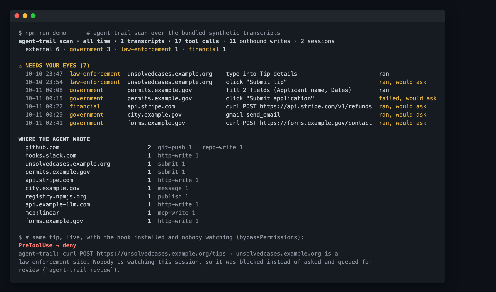

# agent-trail

**A paper trail for everything your AI agent sends out.** It logs every POST, form submit, push, publish and message your Claude Code or Codex agent makes, and asks before the agent writes to government, police, election, court, bank or health sites.

   



<sub>The screenshot runs `npm run demo` over the bundled **synthetic** transcripts in `demo/`, where every `example.*` host is fictional. Nothing in it comes from a real session.</sub>

## Why

In July 2026, an AI model being tested by interacting with randomly selected websites submitted a false homicide tip to a public police tip site. It was submitted on July 18, found on September 28, and the police were told on October 7 ([TechCrunch](https://techcrunch.com/2026/10/09/an-anthropic-ai-model-sent-a-false-homicide-tip-to-philadelphia-police/)). If the lab that built the model needed ten weeks to notice, a solo developer whose agent runs overnight has no chance.

Agents now browse, fill forms, send email, open PRs and call webhooks. Your terminal scrollback is not an audit log. Model usage limits don't cover what the agent *sends*, and permission prompts don't help when nobody is around to answer them (`--dangerously-skip-permissions`, background runs, cron).

agent-trail answers two questions:

1. **What has my agent already sent, and where?** `agent-trail scan` reads your local Claude Code and Codex transcripts. It needs no setup and is read-only.
2. **Can it ask me before submitting to a police tip line, a city permit form or a payment API?** `agent-trail hook` is a Claude Code `PreToolUse` hook. It logs every outbound write, asks about sensitive hosts and blocks them when nobody is watching.

## Quick start

```bash
# 1. See what your agents already sent (last 30 days of local transcripts)
npx -y github:thinx-pro/agent-trail scan

# 2. Install and turn on the live hook for this project (writes .claude/settings.local.json)
npm i -g github:thinx-pro/agent-trail && agent-trail init --write

# 3. Each morning
agent-trail review --since 24h          # add --md review.md for a checklist
```

`agent-trail init` without `--write` only prints the settings snippet. Use `--global` for `~/.claude/settings.json`.

## What counts as "outbound"

| Source | Detected as a write |
|---|---|
| `curl`, `wget`, `http`/`xh` | POST / PUT / PATCH / DELETE, `-d`/`-F`/`--json`/`-T` (method inferred like curl does). GraphQL *queries* sent by POST count as reads; mutations count as writes |
| inline scripts & heredocs | `requests.post`, `httpx.put`, `axios.post`, `fetch(…, {method: "POST"})`, `smtplib`, `nodemailer` in `python -c`, `node -e`, `<<EOF` bodies |
| `gh` | `issue/pr/release/repo/gist/label/secret/workflow…` write sub-commands, and `gh api` with `-X` or fields |
| `git push`, publishes | `git push` (remote resolved), `npm/pnpm/yarn/bun publish`, `twine upload`, `uv/poetry publish`, `cargo publish`, `gem push`, `docker push` |
| `scp` / `rsync` / `ssh`, `mail` | uploads to a remote host, remote shells, mail recipients (domain only) |
| MCP tools | the first verb in the tool name decides: `send_email`, `save_issue`, `notion-create-pages` are writes; `get_release`, `list_issues` are reads. Recipients and URLs in the args become the target host |
| browser MCP (Playwright, Claude in Chrome, the Claude browser pane, Puppeteer) | the hook remembers the page from `navigate`. A click whose label looks like *Submit / Send / Pay / Place order / Report / Vote / Delete…* counts as a submit, and so do pressing Enter, `form.submit()` in page scripts and `fill_form` with `submit: true`. Typing on a sensitive page is logged as context |
| `WebFetch`, `curl` GET | reads: not logged unless `"logReads": true` |

`cd dir && git push`, `sudo`, `env X=1`, `timeout`, `xargs`, `bash -c "…"` wrappers, quotes, pipes and redirections (`2>&1`, `> out.json`) are handled.

## Sensitivity categories

| Category | Matches (suffix or hostname label) | Default |
|---|---|---|
| law-enforcement | `police`, `sheriff`, `crimestoppers`, `unsolved`, `fbi`, `ic3`, `interpol`, `europol`, `*.police.uk` … | ask |
| elections | `vote`, `voter`, `election(s)`, `ballot` labels | ask |
| courts | `court(s)`, `judiciary`, `uscourts`, `pacer`, `tribunal` | ask |
| government | `.gov`, `.mil`, `.gov.xx`, `.gob.xx`, `.go.xx`, `.gouv.xx`, `.gc.ca`, `canada.ca`, `.europa.eu`, `.bund.de`, `.admin.ch`, `.govt.nz` … | ask |
| financial | PayPal, Stripe, Wise, Coinbase, big banks … plus any `*bank*` label and `pay.` / `billing.` / `checkout.` / `wallet.` subdomains | ask |
| health | `nhs.uk`, `mychart`, `patient`, `telehealth`, `pharmacy` labels | ask |
| external | everything else | log |
| internal | `localhost`, private IPs, `.local`, `.test`, `.internal`, bare hostnames | ignore |

**Nobody watching → ask becomes deny.** If the session runs with `permission_mode` `bypassPermissions` or `dontAsk`, nobody will see an "ask" prompt. The hook then denies the call, tells the agent not to retry another way, and lists it under *NEEDS YOUR EYES* in the next review. Set `"unattended": true/false` to override.

The rules live in [`src/domains.js`](src/domains.js) and are short enough to read. You can see exactly why a host was flagged with `agent-trail check "curl -X POST https://…"`.

## Policy file (optional)

Put `.agent-trail.json` in your project (agent-trail searches upward from the working directory), or put `~/.agent-trail/config.json` in your home directory. See [`examples/agent-trail.json`](examples/agent-trail.json):

```json
{
  "rules": { "law-enforcement": "deny", "elections": "deny", "government": "ask", "external": "log" },
  "hosts": { "api.stripe.com": "log", "hooks.slack.com": "log" },
  "categories": { "mycompany.internal.example": "internal" },
  "unattended": "auto",
  "logReads": false
}
```

Decisions: `ignore` (not logged), `log` (allowed and logged), `ask` (Claude Code asks you), `deny`. A `hosts` rule beats a category rule.

## What is stored

Everything goes to `~/.agent-trail/trail.jsonl` (mode 600; set `AGENT_TRAIL_DIR` to move it). Each line records the time, session, cwd, tool, kind, method, host, redacted URL, category and decision, and a later line records whether the call succeeded.

**Body values are never stored.** agent-trail keeps the field names (`name`, `tip`), the byte size and a truncated SHA-256 hash, so you can tell whether two submissions were identical without the log becoming a second copy of what was sent. Query-string values and secret-looking URL path segments (webhook tokens) are replaced with `…`. For mail, only the recipient's domain is kept.

## Also included: a Skill

[`skills/outbound-check/SKILL.md`](skills/outbound-check/SKILL.md) tells the agent to state what it is about to send and where. It also tells the agent to stop and ask before writing to sensitive sites, to never retry a blocked submission through another tool, and to check whether a send already went through before re-sending. Copy it into `~/.claude/skills/` (or your agent's skills directory). It works with or without the hook, and the hook is what enforces it.

## How it works

- `hook`: one short-lived Node process per tool call, with zero dependencies. `PreToolUse` classifies the call, decides, appends the trail and returns `permissionDecision` `ask`/`deny`, or nothing at all, which leaves your normal permission rules in charge. `PostToolUse` / `PostToolUseFailure` closes the entry by `tool_use_id`. The current browser page is kept per session in `~/.agent-trail/state/`.
- **Fails open.** If the hook gets bad stdin, has a bug or hits a broken config, it prints to stderr and allows the call. A logger must not take down your agent, and a bad config is reported loudly by every interactive command.
- `scan`: walks `~/.claude/projects/**/*.jsonl` and `~/.codex/sessions/**/*.jsonl`, replays every tool call through the same classifier and reports *would ask / would deny* under your current policy. It never runs `git` or touches the network.

## Limits & roadmap

- It is a **heuristic** classifier, not a network firewall. A compiled binary, an obfuscated script or a tool with a neutral name (`run`, `execute`) can send data it can't see. For hard egress control, combine it with a sandbox that denies outbound traffic by default.
- Browser hosts come from the last `navigate` call. A click that follows a redirect may be attributed to the previous page, and a click with no label on a sensitive page is logged rather than asked about.
- Category rules are keyword and suffix based, so expect some false positives (`databank.example`) and misses (a city site on a `.com`). Fix them with `categories` in your policy.
- Live hook semantics follow the [Claude Code hooks reference](https://code.claude.com/docs/en/hooks). Codex is supported for `scan` only; Codex has no hook API that this uses yet.
- Roadmap: an HTTP(S) proxy mode for non-Claude agents (mitmproxy addon), a `review --html` page, per-host daily caps, signed/append-only trail export, and a community list of sensitive domains.

## Development

```bash
npm test                     # 17 tests: classifier units + real hook processes over stdin
npm run demo                 # scan the synthetic transcripts in demo/
node scripts/make-demo.js    # regenerate them
```

## License

MIT

---

### 中文说明

**agent-trail：给 AI Agent 对外发出的每一个动作留痕。** 它会记录 Claude Code / Codex 发出的 POST、表单提交、git push、发包和邮件等动作。遇到政府、警方、选举、法院、银行、医疗类网站时，它会先问你；如果是无人值守的会话（bypass 模式），它会直接拦截，并放进第二天早上的审查单。

- `npx -y github:thinx-pro/agent-trail scan`：零配置，回溯扫描本机已有的会话记录，看看 Agent 之前都往外发过什么。只读，不联网。
- `agent-trail init --write`：装上 Claude Code Hook，之后每次对外写操作都会实时记录。
- `agent-trail review --since 24h`：每天早上看一页审查单。

只记录字段名、大小和哈希，**不保存提交的内容**。它是启发式识别，不能替代网络防火墙或沙箱。
